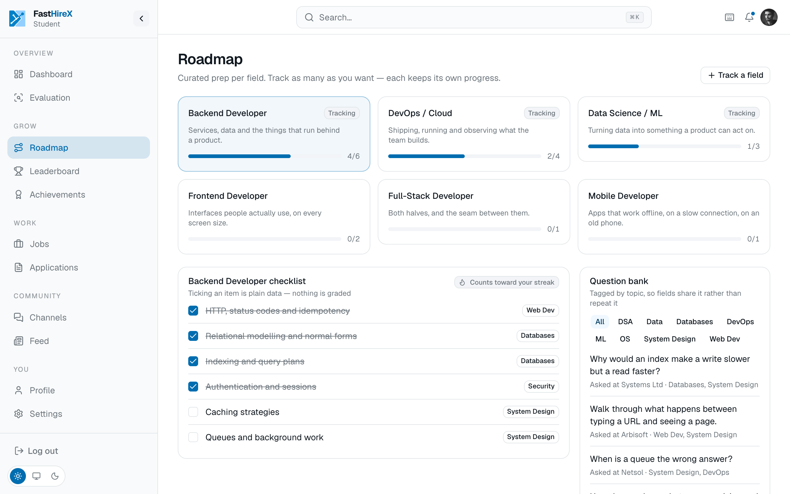
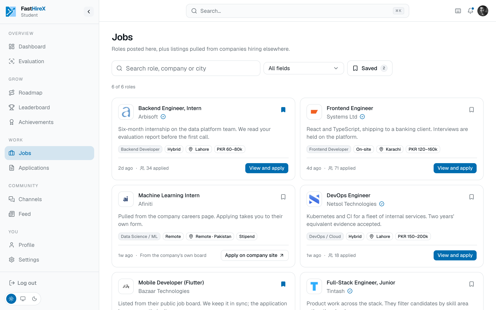

# FastHireX

**Proof over promises.**

A verification layer that turns a student's real work into evidence an employer can trust, and a pool of proven talent that recruiters can actually search.

Final Year Project · Team F26-038 · FAST-NUCES, Lahore

---

> This repository is the **public documentation and product overview** for FastHireX. It is not the application source. It exists so anyone, students, recruiters, and reviewers, can understand what the product is and how it works.

## The short version

Brilliant FAST students grind for four hard years and still disappear into a stack of thousands of resumes. On the other side, companies that would gladly pay for real skill cannot tell who is genuinely good from a one-page document. The gap is not talent. It is **proof**.

FastHireX closes that gap from both sides. A student does real work. We read that work and turn it into an honest, evidence-backed picture of what they can actually do. Employers then search proven talent instead of guessing from resumes. We narrow the search to the people who genuinely fit.

## Who it is for

- **Students** who have done the work and want it to count, not sit unseen in a pile.
- **Recruiters and founders** who want to hire for real skill and judgement, and skip the resume lottery.
- **Communities** of FAST students who want one trusted place to prepare, build, and connect.

## What is inside

| Area | What it does |
|---|---|
| [Problem and solution](docs/problem-and-solution.md) | Why resumes fail both sides, and the gap FastHireX closes |
| [Skill evaluation](docs/skill-evaluation.md) | Reading real work into an evidence-backed skill profile |
| [Roadmaps and prep](docs/roadmaps.md) | Pick a field, follow a roadmap, build a daily habit |
| [Communities](docs/communities.md) | FAST-only course channels, project spaces, and calls |
| [Jobs and hiring](docs/jobs-and-hiring.md) | A two-sided marketplace, from applied to hired |
| [Feed and alumni](docs/feed-and-alumni.md) | A shared feed and alumni social proof |
| [Tech stack](docs/tech-stack.md) | How the product is built, at a high level |
| [Product roadmap](docs/product-roadmap.md) | Scope, status, and what comes next |

## A look at the product

| | |
|---|---|
|  |  |
| **Skill evaluation**, an evidence-backed read of real work | **Roadmaps**, field-based prep with a daily streak |
|  |  |
| **Community channels**, FAST-only, auto-joined by course | **Jobs**, browse and apply, built for both sides |

More in [`screenshots/`](screenshots/).

## The presentation

A full walkthrough of the project is available as a slide deck:

- [FastHireX FYP presentation (PDF)](presentation/FastHireX-FYP-Presentation.pdf)

## About the name

**FastHireX.** "FAST" stands for FAST-NUCES, where it starts. The name is chosen so it survives scaling: as the product expands to other universities, "FAST" reframes to mean *fast*, speed, with no rename needed.

## Team

Final Year Project **F26-038**, Department of Computer Science, FAST-NUCES Lahore.

## Links

- Website: [fasthirex.com](https://fasthirex.com)

---

Documentation only. The product is in active development.

