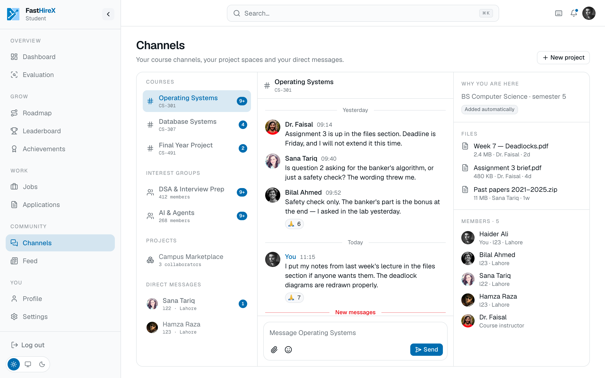

# Communities

A trusted, FAST-only space to prepare, build, and connect. Because signup is gated to verified FAST students, the exclusivity is real, a checkable gate, not a policy statement.

## Course channels, joined automatically

- **Auto-membership by discipline and semester.** A student joins their course channels automatically, which solves the empty-room problem that kills most new communities.
- **A file section per course channel**, carrying curated study material for that course.
- **Curriculum mapping is actively maintained.** The study plan for every degree is kept in step with FAST's official catalog, so course channels stay correct as courses change, rather than drifting out of date.

## Project spaces

Inside their channels, a student can create a **Project space** to organize real work in one place:

- Connect a repository.
- Add friends as collaborators.
- Track assignments and tasks for the project, instead of scattering them across chat apps.

A Project space is structure and organization. It keeps a team's work together and tied to the code.

## Staying connected

- **Direct messages** between students, separate from course and project channels.
- **Jams**, voice and video calls tied to communities and projects, for study groups and collaboration.
- **Moderation** through report and review, to keep the space healthy.
