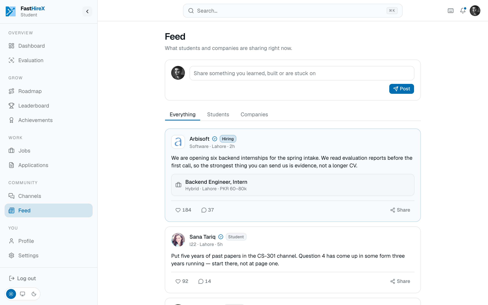

# Feed and alumni

## Community feed

A shared feed, open to any user on the platform, students and employers alike. Student and non-student posts are visually distinct, so it is always clear who is posting. A user's posts also appear on their own profile.

It keeps the platform alive between evaluations and job posts, a place to share wins, ask questions, and stay in the loop.

## Alumni spotlight

The platform highlights notable FAST alumni, their name, current role, and company, as motivation and social proof for current students. Entries are drawn from publicly available information.
