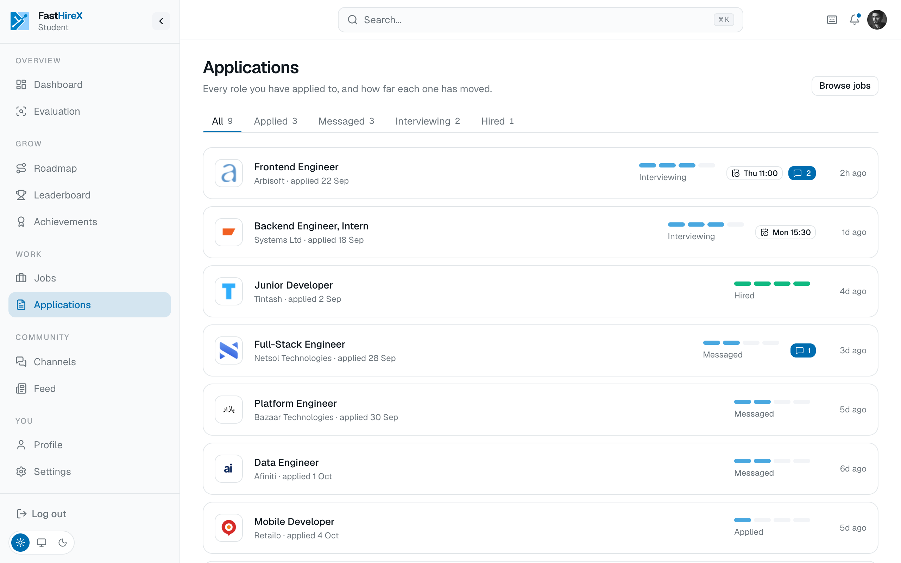

# Jobs and hiring

A two-sided marketplace that connects proven students with employers who want real skill. The platform **never holds money**. There is no escrow and no payment processing, ever. Payment settles entirely off-platform.

## For students

- **A dedicated Jobs area** listing every opening, browsable and filterable, as the main way to discover work.
- **Pre-existing companies are listed too.** Where a company exposes a public job board, listings are pulled in on a schedule; otherwise they are added by an admin. Applying to those redirects the student out to the company's own site, so the platform never sits in the middle of that application.
- **A profile that carries proof**, evaluation results, badges, and a project showcase a student can feature for hirers to see.
- **Profile completion** nudges and **profile view** counts, so a student knows their profile is working for them.

## For employers

- **Search candidates directly** by field, evaluation results, badges, and skill area, instead of only waiting for applicants.
- **A hiring funnel** per posting: applied, messaged, interviewing, hired. The interview stage is a video call held on the platform.
- **A message thread per application**, separate from general community chat.
- **A company profile** with logo, description, industry, and open roles, plus a **shortlist** to save promising candidates for later.
- **A verified-employer badge**, granted through admin review.

## Trust on both sides

- **A lightweight agreement record** on hire, scope, price, and timeline, confirmed digitally by both sides. It is a shared record, not a legal contract.
- **Mutual reviews** on completion, a star rating with written text, never a bare number.
- **Blind release.** Neither side sees the other's review until both submit, or a fixed window passes, which prevents retaliatory reviewing.
- **Reputation badges** earned from review history, so a track record follows people over time.
