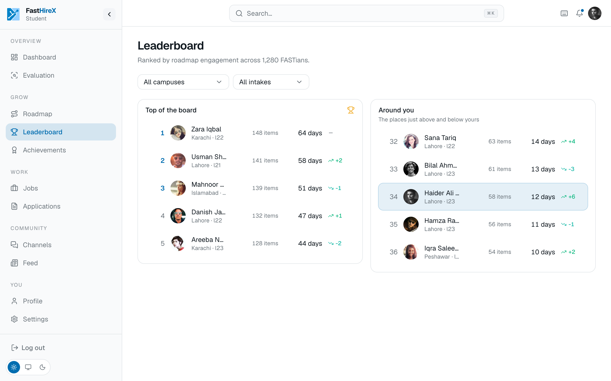

# Roadmaps and prep

Field-based preparation that turns "I want to get better" into a concrete, trackable habit.

## Pick a field, follow a roadmap

Six fields at launch, each with curated prep content:

- Backend Developer
- Frontend Developer
- Full-Stack Developer
- Mobile Developer
- Data Science / ML Engineer
- DevOps / Cloud Engineer

Content is drafted once per field and reviewed by a human before it is published, so students are not handed raw, unchecked material.

## Build a habit, not just a plan

- **Multiple goal checklists at once.** A student is not locked to a single target field. They can run several goals in parallel and track progress on each independently.
- **An interview question bank** for self-study, tagged by topic (web, apps, OOP, data structures, Git, and more) rather than siloed per field, so fields share content instead of duplicating it.
- **A daily streak.** Engaging with the roadmap builds a streak, which turns preparation into a routine.

## See where you stand

Streaks feed a **leaderboard** of FAST students, so a student can see how their effort ranks among other FASTians.

