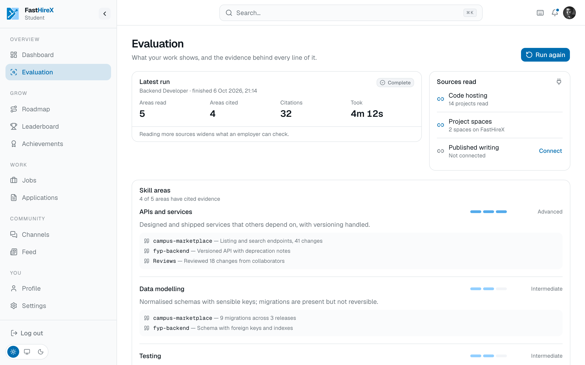

# Skill evaluation

The heart of the platform. It takes a student's real work and produces an evidence-backed picture of their skills, so the result can be trusted rather than taken on faith.

## It reads real work, not a resume

Evaluation is built around what a student has actually done. Code is the obvious case, and a student can connect the tools they already use so their work can be read directly. But the point is the real work itself, not any single platform, and not a self-written profile.

## What the report contains

- **Proficiency per skill area**, each tied to the evidence behind it. A claim never floats on its own.
- **A readiness score shown together with its evidence**, never a bare number with nothing to back it.
- **A gap list** measured against the field the student is aiming for, so the output is not just a grade but a direction.
- **Signals of collaboration and consistency**, not only solo output, so steady, real contribution shows up.

## Honest by design

The evaluation is written to be defensible:

- An empty or thin account gets an honest report, not an inflated one.
- The read is one piece of a fuller profile, alongside roadmap activity, project work, and reputation earned on the platform.
- Work is also checked for whether it looks original rather than copied or templated, and that check is kept explainable.

Evaluation is one important feature of FastHireX, not a magic verdict. It exists to give both sides something real to stand on, and to narrow the search to the people who genuinely fit.
